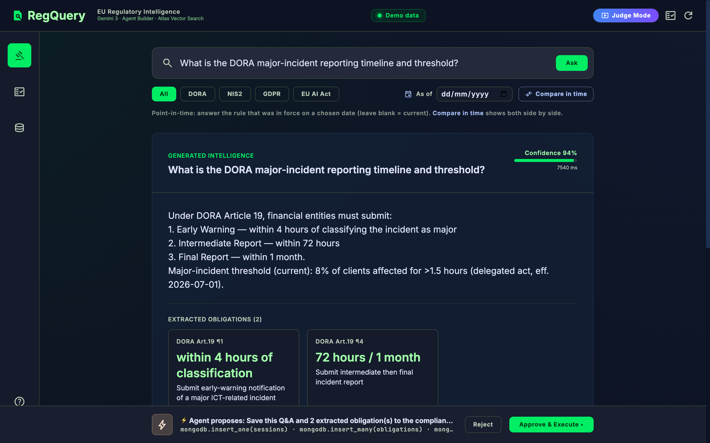
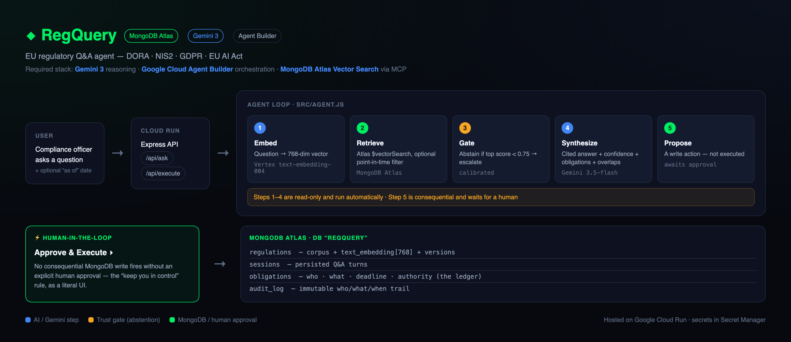
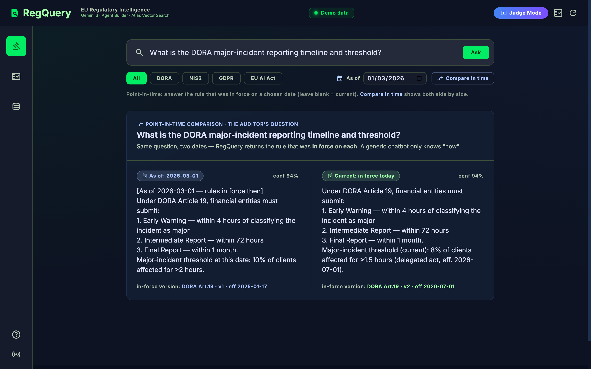
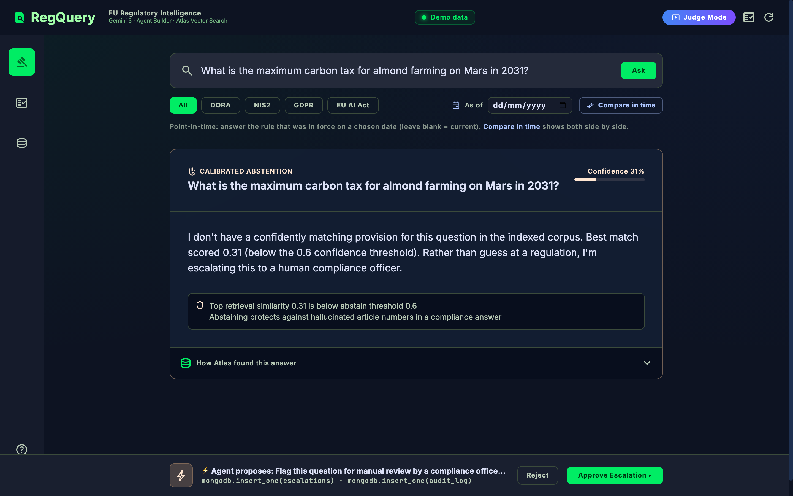
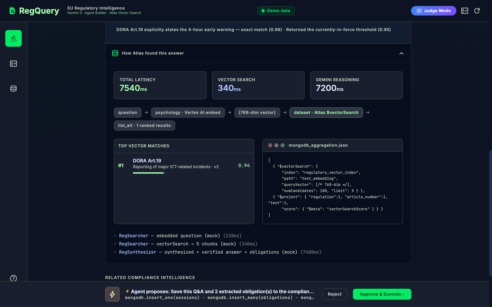
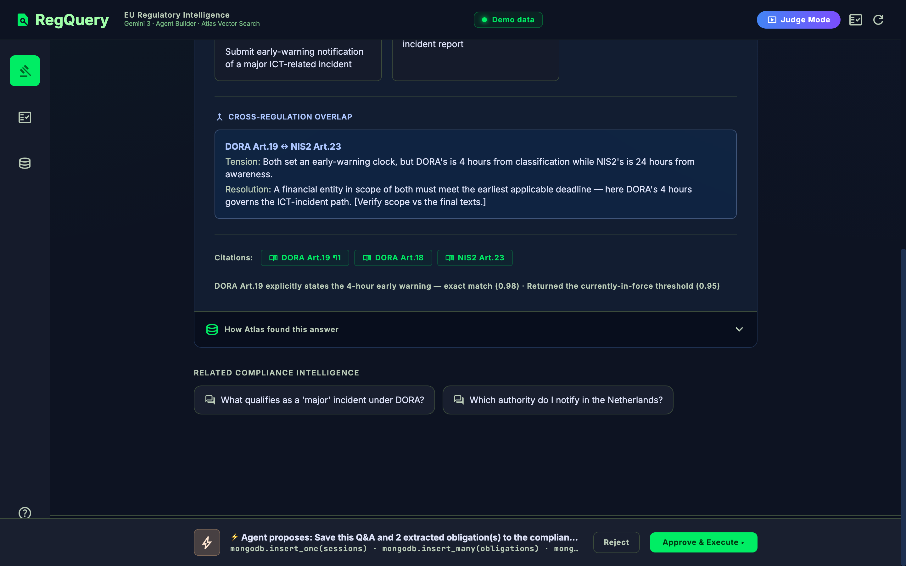
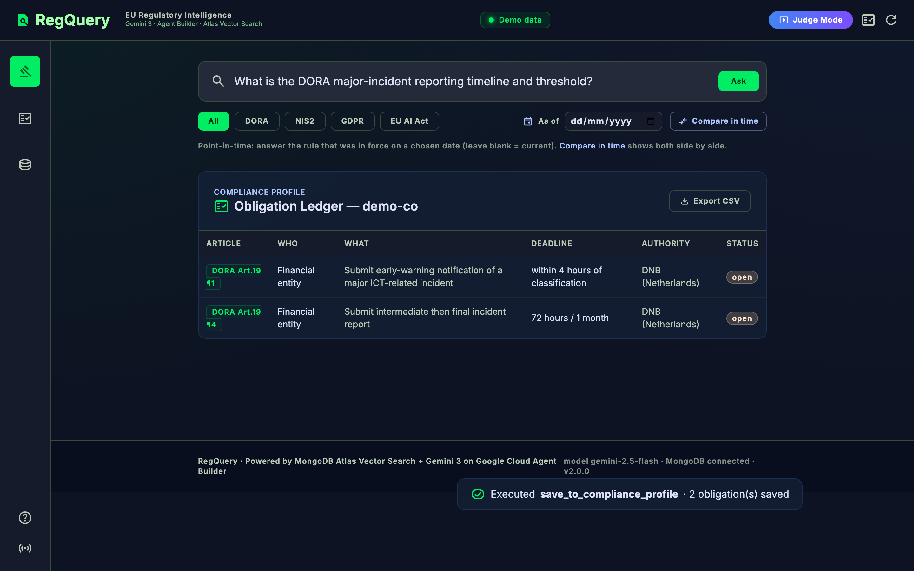
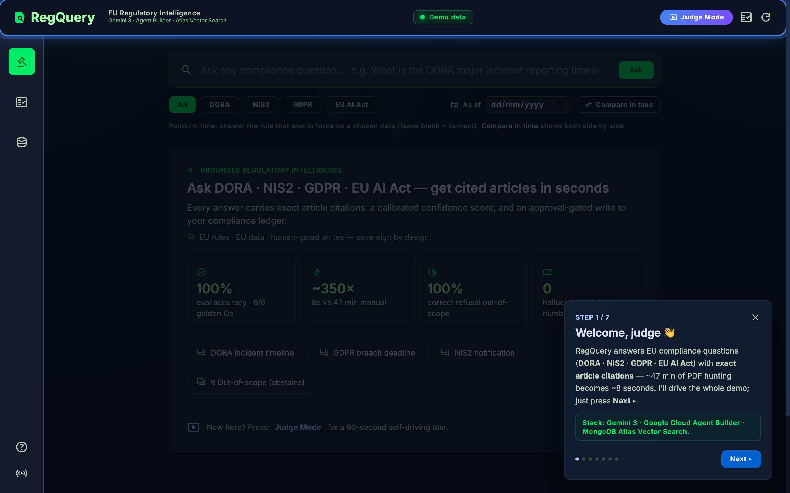

<div align="center">

# ◆ RegQuery — EU Regulatory Intelligence Agent

**Ask any DORA / NIS2 / GDPR / EU AI Act question → get a grounded answer with exact article citations, a calibrated confidence score, point-in-time accuracy, and an approval-gated, auditable write-back.**

~47 minutes of manual PDF hunting → **~8 seconds.**

[](https://regquery-908307939543.europe-west1.run.app)
&nbsp;
[](ARCHITECTURE.md)
&nbsp;
[](DECK.md)

[](https://ai.google.dev/)
[](https://cloud.google.com/products/agent-builder)
[](https://www.mongodb.com/products/platform/atlas-vector-search)
[](https://cloud.google.com/run)
[](https://nodejs.org)
[-10B981)](evals/report.json)
[](LICENSE)

**🔗 Live:** https://regquery-908307939543.europe-west1.run.app &nbsp;·&nbsp; press **▶ Judge Mode** for a 90-second self-driving tour.

</div>



---

## The problem

A compliance officer answering *"what's the DORA major-incident reporting deadline?"* opens a 300-page
PDF, ctrl-Fs for the article, cross-checks NIS2, and hopes the rule hasn't changed since the incident.
It takes ~47 minutes and a generic chatbot can't help — it hallucinates article numbers and only knows
*today's* rules.

## What RegQuery does

A **multi-step agent** (not a chatbot) that retrieves the actual regulation text from **MongoDB Atlas
Vector Search**, reasons over it with **Gemini 3**, and answers with **exact citations** — then proposes
a write-back that **a human must approve**.

| ⭐ Feature | Why it wins |
|---|---|
| **Point-in-time retrieval** | Ask "as of" any date → the rule **as it was in force then**. The exact question an auditor asks. No generic chatbot can do this. |
| **Calibrated abstention** | If retrieval confidence is too low it **refuses and escalates to a human** instead of inventing an article number — the #1 trust signal in compliance. |
| **Cross-regulation overlap** | When regs overlap (DORA ↔ NIS2 deadlines) it surfaces the tension and **how to reconcile** it. |
| **Obligation ledger + audit log** | Every answer extracts structured obligations (*who · what · deadline · authority · trigger*), written on approval to a shared ledger + immutable audit log, **exportable as CSV**. |
| **Human-in-the-loop** | No consequential DB write fires without an explicit **Approve** click. |
| **Judge Mode** | A built-in, self-driving 90-second guided demo that maps each beat to the judging criteria. |

---

## Architecture



Read-only steps (embed → retrieve → gate → synthesize) run automatically; the consequential write is
gated on human approval. Embeddings run on **Vertex `text-embedding-004`** (768-dim) to match the
indexed corpus; synthesis runs on **Gemini 3.5-flash** (AI Studio). Full detail in **[ARCHITECTURE.md](ARCHITECTURE.md)**.

---

## Gallery

| Point-in-time compare (the superpower) | Calibrated abstention |
|---|---|
|  |  |
| **"How Atlas found this answer" — live trace** | **Human-in-the-loop approval** |
|  |  |
| **Obligation ledger + CSV export** | **Judge Mode guided tour** |
|  |  |

---

## Tech stack

| Layer | Technology |
|---|---|
| Reasoning | **Gemini 3.5-flash** (Google AI Studio) |
| Orchestration | **Google Cloud Agent Builder** + **MongoDB MCP** ([`agent-builder/agent.json`](agent-builder/agent.json)) |
| Retrieval | **MongoDB Atlas Vector Search** (`$vectorSearch`, 768-dim cosine) |
| Embeddings | **Vertex AI** `text-embedding-004` |
| Hosting | **Google Cloud Run** (`europe-west1`) · secrets in **Secret Manager** |
| App | Node.js 20 · Express · vanilla JS + Tailwind (vendored) |

---

## Quick start

### Run the full UI on demo data — no credentials
```bash
npm install
MOCK=true npm start          # → http://localhost:8080  (press ▶ Judge Mode)
```

### Run it live (real Atlas + Gemini)
```bash
cp .env.example .env         # fill in GEMINI_API_KEY + ATLAS_CONNECTION_STRING
npm install
npm run ingest               # embed + index the corpus into Atlas
npm start
```

### Deploy to Cloud Run (one shot)
```bash
# fills Secret Manager, ingests, ensures the vector index, live-evals, deploys MOCK-off
bash scripts/golive.sh
```

### Configuration

Copy `.env.example` to `.env`. The model client picks its auth path automatically: **AI Studio** when `GEMINI_API_KEY` (or `GOOGLE_API_KEY`) is set, otherwise **Vertex AI** with Google Cloud application-default credentials.

| Variable | Default | Meaning |
|---|---|---|
| `GEMINI_API_KEY` | none | Use the Gemini Developer API (AI Studio). Not listed in `.env.example`; add it if you use this path |
| `GOOGLE_CLOUD_PROJECT`, `GOOGLE_CLOUD_LOCATION` | none, `europe-west1` | Vertex AI project and region, used when no API key is set |
| `GOOGLE_GENAI_USE_VERTEXAI` | `true` | Prefer Vertex. Ignored when an API key is set |
| `GEMINI_MODEL` | `gemini-3` | Model for answer synthesis |
| `EMBEDDING_MODEL` | `text-embedding-004` | Model for embeddings |
| `ATLAS_CONNECTION_STRING` | none | MongoDB Atlas connection string (required unless `MOCK=true`) |
| `ATLAS_DB`, `ATLAS_COLLECTION`, `ATLAS_VECTOR_INDEX` | `regquery`, `regulations`, `regulatory_vector_index` | Database, collection and Atlas vector index names |
| `ABSTAIN_THRESHOLD` | `0.6` | If the top hit's similarity is below this (0 to 1), RegQuery refuses to answer and escalates to a human. Raise it for stricter, lower it for chattier |
| `MOCK` | off | `true` runs the whole UI and approval flow with canned data and no credentials |
| `PORT` | `8080` | HTTP port |
| `EVAL_TARGET` | `0.8` | Pass mark used by `npm run eval` |

### Scripts

| Command | What it does |
|---|---|
| `npm start` | Start the server |
| `npm run dev` | Start with `node --watch` (restarts on file changes) |
| `npm run ingest` | Embed the corpus and index it into Atlas |
| `npm run eval` | Run the golden Q&A evaluation in `evals/golden-qa.json` and write `evals/report.json` |

---

## Evaluation

A golden-set harness scores article recall, keyword presence, abstention, and point-in-time
([`scripts/eval.js`](scripts/eval.js) · [`evals/golden-qa.json`](evals/golden-qa.json)):

```
RegQuery — grounded-answer eval (LIVE full set: 6 cases)
  ✅ DORA major-incident timeline      articles 100% · keywords 67%
  ✅ DORA threshold (point-in-time)    articles 100% · keywords 100%
  ✅ GDPR breach notification          articles 100% · keywords 100%
  ✅ DORA ICT third-party register     articles 100% · keywords 100%
  ✅ NIS2 incident notification        articles 100% · keywords 100%
  ✅ out-of-scope                      correctly abstained
  Accuracy 100.0% (6/6)
```
Run it: `npm run eval` (live) or `MOCK=true npm run eval` (offline subset).

> ⚠️ **Corpus note:** [`data/`](data/) ships a small **seed** corpus with `[VERIFY]` markers. Verify
> every article number against the official EUR-Lex text before any real use — a wrong article number
> is the one unforgivable bug in a compliance tool.

---

## Repository layout
```
src/            agent loop (agent.js), model clients (ai.js), Atlas + ledger (mongo.js), server.js
public/         single-page UI (Judge Mode, point-in-time compare, ledger)
scripts/        ingest.js · eval.js · ensure-index.mjs · golive.sh · screenshots.mjs
agent-builder/  the JUDGED Agent Builder agent (Gemini 3 + MongoDB MCP, human approval)
data/           seed regulation corpus (DORA/NIS2/GDPR/EU AI Act)
evals/          golden-qa.json + report.json
```

Built for the **Google Cloud Rapid Agent Hackathon** (MongoDB bucket).

## License
[MIT](LICENSE)
